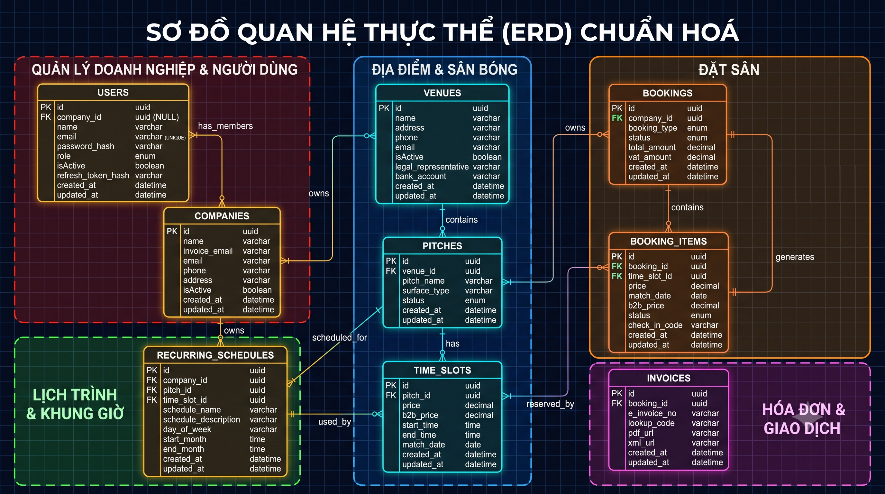
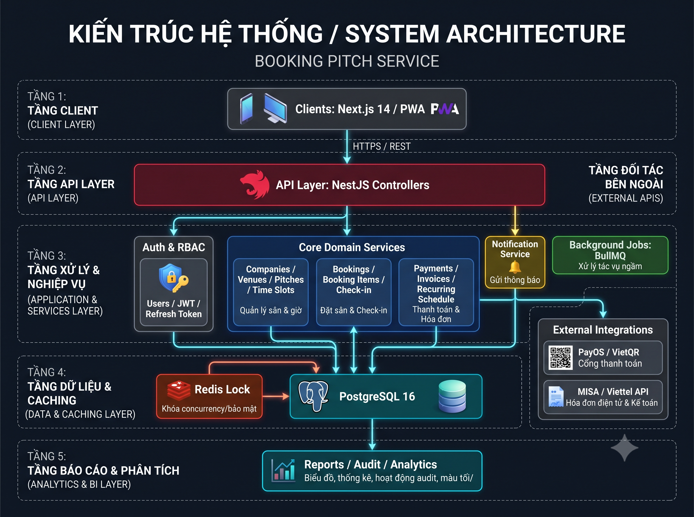

# BookingPitchService - Architecture & Delivery Schedule

## 1. Tổng quan hệ thống

Hệ thống quản lý đặt sân bóng theo mô hình SaaS/portal đa kênh, gồm:

- Corporate Web Portal: dành cho khách hàng doanh nghiệp / HR / kế toán
- Venue Web App: dành cho chủ sân / quản lý sân
- Backend Core: xử lý auth, phân quyền, đặt sân, thanh toán, hóa đơn, lịch lặp, check-in
- Integrations: PayOS, VietQR, MISA/Viettel API
- Data layer: PostgreSQL 16, Redis, BullMQ

## 2. Kiến trúc hệ thống

## 3. Mô hình module backend đề xuất

### 3.1 Core domain

- `users`: tài khoản đăng nhập, token, role, trạng thái active
- `auth`: login, refresh token, logout, guard, strategy
- `companies`: tenant / khách hàng doanh nghiệp / đối tác
- `venues`: sân vận động / khu thể thao / điểm đặt
- `pitches`: sân bóng cụ thể thuộc một venue
- `time-slots`: khung giờ theo từng pitch
- `bookings`: đặt lịch, trạng thái booking, tổng tiền
- `booking-items`: chi tiết booking theo pitch / slot / giá
- `recurring-schedules`: lịch lặp, lịch định kỳ
- `invoices`: hóa đơn điện tử / PDF / XML
- `payments`: thanh toán, QR, callback, refund
- `notifications`: thông báo cho venue owner, customer, admin

### 3.2 Cross-cutting concerns

- `common`: enums, base entity, filters, interceptors, decorators
- `config`: database config, app config
- `guards`: auth guard, role guard
- `pipes`: validation
- `exceptions`: custom exceptions
- `utils`: helpers, formatter, code generation

## 4. Luồng nghiệp vụ chính

### 4.1 Đặt sân

1. Client gọi API tạo booking
2. Backend kiểm tra quyền, trạng thái pitch, slot còn trống
3. Redis lock khóa slot để tránh race condition
4. Tạo booking + booking items
5. Tạo thanh toán / QR code / link thanh toán
6. Cập nhật trạng thái booking
7. Lưu event vào queue cho xử lý nền

### 4.2 Check-in / check-out

1. Venue app xác nhận booking theo check-in code
2. Backend validate thời gian và trạng thái
3. Cập nhật trạng thái `checked_in`, `in_progress`, `completed`
4. Gửi notification cho chủ sân / khách hàng

### 4.3 Hóa đơn

1. Booking thành công => tạo invoice
2. Invoice sync với phần mềm kế toán / MISA
3. Tạo chứng từ điện tử nếu cần
4. Theo dõi trạng thái thanh toán và VAT

### 4.4 Lịch lặp

1. Tạo recurring schedule
2. Sinh các instance booking / slot theo định kỳ
3. Kiểm tra trùng lịch, slot đã đặt
4. Cập nhật các record child theo thời gian

## 5. Yêu cầu kỹ thuật

### 5.1 Backend

- NestJS 12
- TypeORM + PostgreSQL 16
- Validation và DTO rõ ràng
- RBAC / auth middleware
- Queue processing (BullMQ)
- Redis lock để chống race condition
- API versioning nếu có triển khai dài hạn

### 5.2 Mức độ production readiness

- Logging + tracing
- API rate limit
- Retry / timeout cho external payment và invoice provider
- Idempotency key cho payment
- Audit trail (created_by, updated_by, created_at, updated_at)
- Pagination + filter query

## 6. Kế hoạch thực hiện theo giai đoạn

### Giai đoạn 1 — Foundation (Tuần 1-2)

Mục tiêu: dựng nền tảng kỹ thuật và model dữ liệu cốt lõi.

- Thiết lập project NestJS + cấu hình môi trường
- Kết nối PostgreSQL 16
- Cấu trúc module chuẩn
- Base entity, enum, DTO, validation
- Auth cơ bản + RBAC mẫu
- Thiết lập database và migration framework
- Xây dựng `companies`, `venues`, `pitches`

Deliverables:

- App bootstrapped
- DB schema sơ bộ
- CRUD cơ bản cho company/venue/pitch

### Giai đoạn 2 — Booking engine (Tuần 3-5)

Mục tiêu: cho phép đặt sân cơ bản và quản lý khung giờ.

- `time-slots` module
- `bookings` module
- `booking-items` module
- kiểm tra trùng lịch / slot
- Redis lock khi đặt lịch
- API create/update/cancel booking
- trạng thái booking theo workflow

Deliverables:

- booking flow hoàn chỉnh cơ bản
- xác nhận/huỷ lịch
- chống race condition đầu tiên

### Giai đoạn 3 — Thanh toán & hóa đơn (Tuần 6-7)

Mục tiêu: tích hợp thanh toán và phát hành hóa đơn.

- payment provider adapter
- tạo QR / link thanh toán
- webhook xử lý kết quả thanh toán
- `invoices` module
- status tracking: pending / paid / failed / refunded
- sync hóa đơn với MISA / Viettel

Deliverables:

- payment flow end-to-end
- invoice generation
- callback xử lý thành công/thất bại

### Giai đoạn 4 — Lịch lặp & automation (Tuần 8-9)

Mục tiêu: mở rộng cho hoạt động doanh nghiệp và lịch định kỳ.

- `recurring-schedules` module
- sinh đặt lịch lặp theo tuần/tháng
- quản lý thời gian, thời lượng, chu kỳ
- job xử lý lịch định kỳ bằng BullMQ
- tính năng xem trước lịch

Deliverables:

- recurring booking automation
- tính năng sinh lịch tự động

### Giai đoạn 5 — Venue app & check-in (Tuần 10-11)

Mục tiêu: hỗ trợ chủ sân quản lý thực tế.

- API check-in + status cập nhật
- timeline sân / lịch thi đấu
- báo cáo trực tiếp cho venue owner
- notification event cho admin và customer

Deliverables:

- venue operations workflow
- dashboard dữ liệu cơ bản

### Giai đoạn 6 — Hardening, QA & deployment (Tuần 12)

Mục tiêu: sẵn sàng triển khai production.

- test unit + integration
- phân tích bảo mật
- tối ưu query, index DB
- logging / monitoring / alerting
- deploy staging -> production
- smoke test / rollback plan

Deliverables:

- release candidate
- production checklist
- runbook vận hành

## 7. Lộ trình 12 tuần đề xuất

| Tuần | Giai đoạn          | Mục tiêu chính                        |
| ---- | ------------------ | ------------------------------------- |
| 1    | Foundation         | Setup repo, config, DB, base code     |
| 2    | Foundation         | Company/Venue/Pitch CRUD              |
| 3    | Booking engine     | Time slots & reservation rules        |
| 4    | Booking engine     | Booking + booking-items               |
| 5    | Booking engine     | Redis lock, validations, status flow  |
| 6    | Payment & invoice  | PayOS/VietQR integration              |
| 7    | Payment & invoice  | Invoice creation + webhook            |
| 8    | Recurring schedule | Rule engine + recurring data          |
| 9    | Recurring schedule | Job automation + validity checks      |
| 10   | Venue app          | Check-in, dashboard, operational data |
| 11   | QA                 | Hardening, test, optimization         |
| 12   | Release            | Deploy, smoke test, rollback plan     |

## 8. Các rủi ro cần kiểm soát

- Race condition khi nhiều người đặt cùng slot
- Trùng lịch khi recurring schedule sinh nhiều record
- Trạng thái booking không đồng bộ giữa payment và booking
- Dữ liệu hóa đơn không đúng chuẩn với MISA/Viettel
- Nợ hiệu suất khi query lịch sân theo nhiều điều kiện

## 9. Khuyến nghị triển khai ưu tiên

Nếu muốn phát triển theo kiểu thực tế và tối ưu ngân sách, nên ưu tiên theo thứ tự:

1. `companies` -> `venues` -> `pitches`
2. `time-slots` -> `bookings` -> `booking-items`
3. `payments` -> `invoices`
4. `recurring-schedules`
5. `notifications` + `check-in` dashboard

## 10. Kết luận

Hệ thống này nên theo mô hình modular, backend-centric và transaction-safe, với trọng tâm là:

- booking correctness
- payment integrity
- slot concurrency control
- flexible recurring schedule engine

Đây là nền tảng đủ mạnh để mở rộng lên portal doanh nghiệp, app chủ sân và các tính năng kế toán / hóa đơn sau này.

## 11. ERD đã chỉnh sửa theo code hiện tại

### 11.1 Các lỗi chính trong sơ đồ ban đầu

- `Companies` đang bị lệch field so với entity thực tế: sơ đồ cũ có `tax_code` và `contact_email`, trong khi code hiện tại dùng `invoice_email`, `email`, `phone`, `address`, `isActive`.
- `Venues` bị thiếu `phone` và `isActive`.
- `Pitches` bị thiếu quan hệ `venue_id` trong mô tả field chi tiết và thiếu `status`.
- `TimeSlots` bị thiếu `match_date`.
- `Bookings` đang ghi enum kiểu `SINGLE | RECURRING_MONTHLY | EVENT_COMBO`, nhưng code hiện tại dùng `pitch | recurring_monthly | recurring_weekly | event_combo`.
- `BookingItems` bị thiếu `match_date`.
- `RecurringSchedules` trong code hiện tại vẫn dùng `start_month` và `end_month`, nhưng nên cân nhắc đổi tên sau vì đây là thời gian, không phải tháng.

### 11.2 ERD chuẩn hoá

## 12. Danh sách API backend cần build

### 12.1 Nguyên tắc thiết kế API

- RESTful theo module, prefix thống nhất như `/api/v1`.
- Tất cả list endpoint phải hỗ trợ pagination, filter, sort cơ bản.
- CRUD chính dùng `GET`, `POST`, `PATCH`, `DELETE`.
- Các luồng nghiệp vụ đặc biệt dùng action endpoint như `confirm`, `cancel`, `check-in`, `sync`, `preview`.
- Response nên thống nhất format `{ data, meta, message }`.

### 12.2 Auth & RBAC

- `POST /auth/login`: đăng nhập.
- `POST /auth/logout`: đăng xuất.
- `POST /auth/refresh`: làm mới access token.
- `POST /auth/register`: tạo tài khoản mới nếu có self-signup.
- `POST /auth/forgot-password`: gửi link/OTP reset mật khẩu.
- `POST /auth/reset-password`: đặt lại mật khẩu.
- `GET /auth/me`: lấy thông tin user đang đăng nhập.
- `GET /users`: danh sách user.
- `GET /users/:id`: chi tiết user.
- `POST /users`: tạo user.
- `PATCH /users/:id`: cập nhật user.
- `DELETE /users/:id`: xoá hoặc vô hiệu hoá user.
- `GET /roles`: danh sách role.
- `POST /roles`: tạo role.
- `PATCH /roles/:id`: cập nhật role.
- `DELETE /roles/:id`: xoá role.
- `GET /permissions`: danh sách permission.

### 12.3 Companies

- `GET /companies`: danh sách company.
- `GET /companies/:id`: chi tiết company.
- `POST /companies`: tạo company.
- `PATCH /companies/:id`: cập nhật company.
- `DELETE /companies/:id`: xoá hoặc inactive company.
- `GET /companies/:id/bookings`: booking theo company.
- `GET /companies/:id/recurring-schedules`: lịch lặp theo company.

### 12.4 Venues

- `GET /venues`: danh sách venue.
- `GET /venues/:id`: chi tiết venue.
- `POST /venues`: tạo venue.
- `PATCH /venues/:id`: cập nhật venue.
- `DELETE /venues/:id`: xoá hoặc inactive venue.
- `GET /venues/:id/pitches`: danh sách pitch theo venue.
- `GET /venues/:id/availability`: xem lịch trống theo ngày.
- `GET /venues/:id/dashboard`: dashboard tổng quan của venue.

### 12.5 Pitches

- `GET /pitches`: danh sách pitch.
- `GET /pitches/:id`: chi tiết pitch.
- `POST /pitches`: tạo pitch.
- `PATCH /pitches/:id`: cập nhật pitch.
- `DELETE /pitches/:id`: xoá hoặc inactive pitch.
- `GET /pitches/:id/time-slots`: danh sách slot của pitch.
- `GET /pitches/:id/recurring-schedules`: lịch lặp của pitch.

### 12.6 Time slots

- `GET /time-slots`: danh sách slot, filter theo pitch/date/status.
- `GET /time-slots/:id`: chi tiết slot.
- `POST /time-slots`: tạo slot thủ công.
- `PATCH /time-slots/:id`: cập nhật slot.
- `DELETE /time-slots/:id`: xoá slot.
- `GET /time-slots/available`: slot còn trống theo pitch/date.
- `GET /time-slots/conflicts`: kiểm tra slot trùng trước khi đặt.

### 12.7 Bookings

- `GET /bookings`: danh sách booking.
- `GET /bookings/:id`: chi tiết booking.
- `POST /bookings`: tạo booking.
- `PATCH /bookings/:id`: cập nhật booking.
- `POST /bookings/:id/confirm`: xác nhận booking.
- `POST /bookings/:id/cancel`: huỷ booking.
- `POST /bookings/:id/check-in`: check-in.
- `POST /bookings/:id/check-out`: check-out.
- `POST /bookings/:id/complete`: hoàn tất booking.
- `GET /bookings/:id/timeline`: lịch sử trạng thái booking.
- `GET /bookings/:id/items`: danh sách booking items.

### 12.8 Booking items

- `GET /booking-items`: danh sách booking item.
- `GET /booking-items/:id`: chi tiết booking item.
- `POST /booking-items`: tạo booking item.
- `PATCH /booking-items/:id`: cập nhật booking item.
- `DELETE /booking-items/:id`: xoá booking item.
- `GET /booking-items/by-slot/:timeSlotId`: item theo slot.

### 12.9 Payments

- `GET /payments`: danh sách payment.
- `GET /payments/:id`: chi tiết payment.
- `POST /payments/create-intent`: tạo payment intent.
- `POST /payments/:id/confirm`: xác nhận payment nội bộ.
- `POST /payments/:id/refund`: hoàn tiền nếu hỗ trợ.
- `POST /payments/webhook/payos`: webhook từ PayOS.
- `POST /payments/webhook/vietqr`: webhook hoặc callback từ VietQR.
- `GET /bookings/:id/payment`: payment gắn với booking.

### 12.10 Invoices

- `GET /invoices`: danh sách invoice.
- `GET /invoices/:id`: chi tiết invoice.
- `POST /invoices`: tạo invoice từ booking.
- `PATCH /invoices/:id`: cập nhật invoice.
- `POST /invoices/:id/sync`: đồng bộ hóa đơn với MISA/Viettel.
- `POST /invoices/webhook/misa`: nhận callback từ hệ thống hoá đơn.
- `GET /bookings/:id/invoice`: invoice theo booking.
- `GET /invoices/:id/download`: tải PDF/XML.

### 12.11 Recurring schedules

- `GET /recurring-schedules`: danh sách lịch lặp.
- `GET /recurring-schedules/:id`: chi tiết lịch lặp.
- `POST /recurring-schedules`: tạo lịch lặp.
- `PATCH /recurring-schedules/:id`: cập nhật lịch lặp.
- `DELETE /recurring-schedules/:id`: xoá lịch lặp.
- `POST /recurring-schedules/:id/preview`: xem trước các slot sẽ sinh ra.
- `POST /recurring-schedules/:id/generate`: sinh booking/slot con.
- `POST /recurring-schedules/:id/pause`: tạm dừng lịch.
- `POST /recurring-schedules/:id/resume`: chạy lại lịch.
- `GET /recurring-schedules/conflicts`: kiểm tra trùng lịch.

### 12.12 Check-in & venue dashboard

- `POST /check-in/validate`: kiểm tra check-in code.
- `POST /check-in/:bookingId`: check-in booking.
- `POST /check-out/:bookingId`: check-out booking.
- `GET /venue-dashboard/overview`: tổng quan vận hành.
- `GET /venue-dashboard/today-bookings`: booking hôm nay.
- `GET /venue-dashboard/slots`: lịch sân theo ngày/giờ.
- `GET /venue-dashboard/revenue`: doanh thu cơ bản.
- `GET /venue-dashboard/occupancy`: tỷ lệ lấp đầy sân.

### 12.13 API hệ thống

- `GET /health`: health check.
- `GET /ready`: readiness check.
- `GET /version`: phiên bản hiện tại.
- `GET /metrics`: metrics nếu có monitoring.
- `GET /audit-logs`: audit trail.
- `GET /audit-logs/:id`: chi tiết audit log.

### 12.14 MVP ưu tiên trước

Nếu cần build nhanh để chạy end-to-end, ưu tiên theo thứ tự:

1. Auth + RBAC.
2. Companies + Venues + Pitches.
3. Time slots + Bookings + Booking items.
4. Payments.
5. Invoices.
6. Recurring schedules.
7. Check-in + venue dashboard.

## 13. Luồng hoạt động của từng bảng

### 13.1 Users

- `users` là bảng tài khoản đăng nhập của hệ thống.
- User dùng để đăng nhập, nhận access token, refresh token và kiểm tra quyền truy cập.
- Trong phạm vi hiện tại, mỗi user là một đại diện đăng ký cho một company.
- User gắn với company qua `company_id` (không dùng mô hình group mời thành viên).
- Khi user thao tác nghiệp vụ, hệ thống dùng thông tin user hiện tại để ghi nhận quyền và audit nếu cần.

### 13.2 Companies

- `companies` là bảng tenant / khách hàng doanh nghiệp / đối tác.
- Mỗi company có một tài khoản user đại diện để quản lý nghiệp vụ.
- Company có thể sở hữu nhiều booking và nhiều recurring schedule.
- Khi tạo booking, hệ thống chọn company để biết booking thuộc bên nào.
- Khi hiển thị lịch đặt, doanh nghiệp có thể xem toàn bộ booking thuộc company của mình.

### 13.3 Venues

- `venues` đại diện cho sân vận động, khu thể thao hoặc điểm đặt.
- Một venue có thể có nhiều pitch.
- Venue là lớp quản lý cấp cao hơn pitch, dùng để gom thông tin địa điểm, liên hệ và tài khoản ngân hàng.
- Khi tra cứu lịch trống, hệ thống thường đi từ venue xuống các pitch bên trong.

### 13.4 Pitches

- `pitches` là sân bóng cụ thể trong một venue.
- Mỗi pitch thuộc đúng một venue.
- Pitch là đơn vị chính để tạo time slot và lịch lặp.
- Khi có thay đổi trạng thái pitch, hệ thống sẽ ảnh hưởng đến các slot liên quan.

### 13.5 TimeSlots

- `time_slots` lưu từng khung giờ cụ thể của một pitch theo ngày.
- Mỗi slot thuộc đúng một pitch.
- Slot có giá thường và giá B2B để phục vụ các kịch bản giá khác nhau.
- Booking item sẽ tham chiếu vào slot đã đặt để tránh trùng lịch.
- Recurring schedule cũng có thể dùng slot này để sinh lịch lặp.

### 13.6 Bookings

- `bookings` là bảng nghiệp vụ trung tâm, đại diện cho một lần đặt sân.
- Booking thuộc về một company.
- Booking chứa tổng tiền, VAT và trạng thái xử lý như holding, confirmed, completed, cancelled.
- Một booking có thể có nhiều booking item nếu đặt nhiều slot hoặc nhiều sân trong một lần.
- Booking cũng là bảng cha để sinh invoice sau khi xác nhận hoặc thanh toán thành công.

### 13.7 BookingItems

- `booking_items` là các dòng chi tiết của một booking.
- Mỗi booking item liên kết một booking với một time slot cụ thể.
- Đây là nơi lưu giá thực tế, giá B2B, ngày thi đấu và mã check-in.
- Nếu booking là “hóa đơn tổng”, booking item là “dòng hàng chi tiết” cho từng khung giờ.
- Khi huỷ booking, booking item cũng được huỷ hoặc giải phóng slot tương ứng.

### 13.8 Invoices

- `invoices` là bảng hóa đơn gắn với booking.
- Một booking hiện tại tạo một invoice theo quan hệ one-to-one.
- Invoice lưu mã hoá đơn, lookup code, link PDF và XML.
- Khi booking hoàn tất thanh toán, hệ thống tạo hoặc đồng bộ invoice với MISA/Viettel.
- Invoice dựa vào booking để lấy tổng tiền, VAT và thông tin bên mua.

### 13.9 RecurringSchedules

- `recurring_schedules` lưu rule cho lịch lặp định kỳ.
- Một recurring schedule gắn với company, pitch và có thể gắn với time slot mục tiêu.
- Bảng này dùng để sinh ra các slot hoặc booking con theo tuần/tháng.
- Khi job nền chạy, hệ thống đọc recurring schedule, kiểm tra trùng lịch rồi tạo dữ liệu phát sinh.
- Nếu lịch lặp bị pause hoặc resume, hệ thống chỉ thay đổi trạng thái rule, không xoá dữ liệu lịch cũ.

### 13.10 Luồng dữ liệu end-to-end

1. Admin hoặc venue owner tạo `venues` và `pitches`.
2. Hệ thống tạo `time_slots` theo pitch và ngày.
3. Customer hoặc company user tạo `bookings`.
4. Hệ thống thêm `booking_items` để giữ từng slot đã chọn.
5. Sau khi xác nhận hoặc thanh toán, hệ thống tạo `invoices`.
6. Nếu là lịch lặp, hệ thống dùng `recurring_schedules` để sinh thêm slot hoặc booking mới.
7. Mọi thao tác đọc dữ liệu đều đi theo quan hệ cha-con để tránh lệch lịch và tránh đặt trùng slot.

### 13.11 Tóm tắt quan hệ dữ liệu

- `users` -> tài khoản đại diện company, quan hệ 1-1 với `companies` qua `company_id`.
- `companies` -> chủ sở hữu booking và recurring schedule.
- `venues` -> chứa nhiều `pitches`.
- `pitches` -> chứa nhiều `time_slots`.
- `time_slots` -> được đặt bởi `booking_items`.
- `bookings` -> chứa nhiều `booking_items` và sinh `invoices`.
- `recurring_schedules` -> dùng để sinh dữ liệu cho `time_slots` hoặc `bookings` theo quy tắc.
